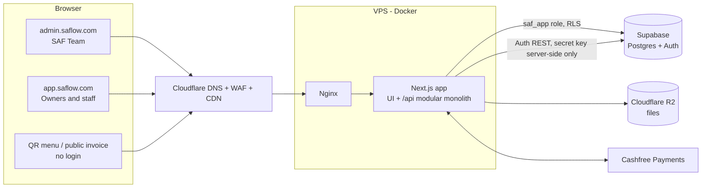
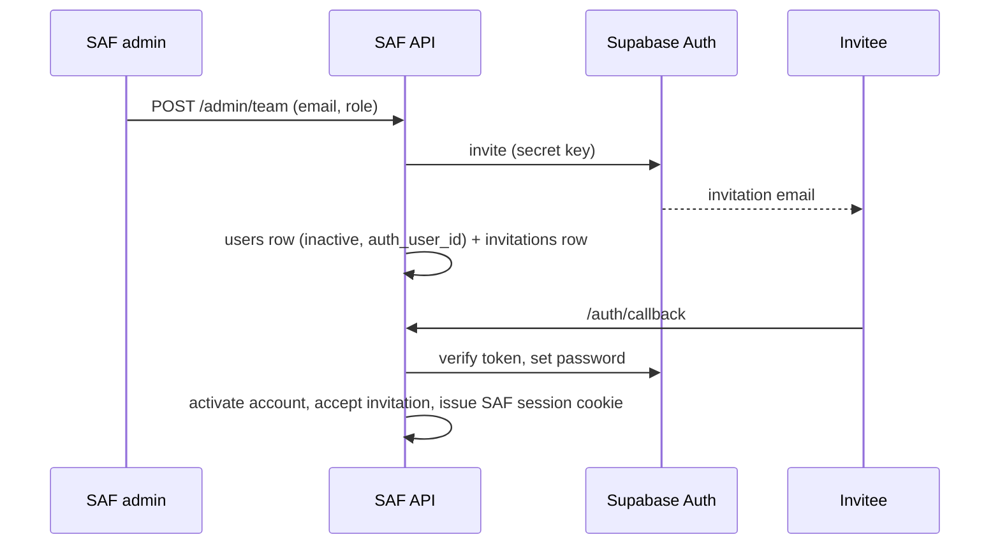
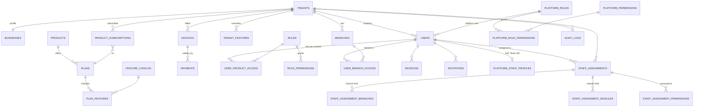

# SAF Flow – Architecture, Security Model and Roadmap

SAF Flow is SmartAutoFlex's multi-tenant SaaS platform. One deployment hosts
the SmartAutoFlex administration panel and every customer workspace (SAF Dine
Flow, SAF Stay Flow, SAF Bill Flow, and future modules).

This document records the architecture decided at the start of the SAF Flow
build (Phase 1, November 2026). [ARCHITECTURE.md](ARCHITECTURE.md) explains the
existing modules in more depth.

---

## 1. Starting point and decisions

SAF Flow builds on an existing working codebase (previously branded
SMARTAUTO FLEX). It already provided:

- Multi-tenant PostgreSQL with Row-Level Security (RLS).
- Super Admin onboarding, plans and pricing, subscriptions and UPI payments (QR + receipt upload, verified by the Super Admin).
- All three products with staff, roles and attendance.
- An automated test suite.

That work is preserved. Phase 1 changes the foundation in four places.

| Decision | Choice | Why |
|---|---|---|
| Identity | **Supabase Auth** for email accounts (owners, managers, SAF Team). Local `CODE@name` login IDs for floor staff without email. | Invitations, email verification and password reset by email, as the spec requires. Waiters and cooks often have no email address. |
| Authorization | Kept on the **SAF server**: route policies, platform RBAC, product RBAC, RLS. Supabase is never asked "may this user do X". | One place enforces every rule, for both kinds of account. Authorization logic never runs in the browser. |
| Database | PostgreSQL 17, local Docker for development, **Supabase Postgres** for staging and production. | Same engine everywhere; Supabase is managed Postgres with backups. |
| Hosting | Next.js app in **Docker on a VPS** (Hetzner or DigitalOcean). Cloudflare for DNS, CDN/WAF and R2 storage. | The server uses native modules (argon2, Prisma engines) that do not run on Cloudflare Workers. |

AWS is not used anywhere.

### What Supabase is used for (and what not)

| Supabase feature | Used? | Notes |
|---|---|---|
| Postgres | Yes (staging/prod) | Through the non-superuser `saf_app` role so RLS applies. |
| Auth (GoTrue) | Yes | Password check, invite, recovery, email confirmation, account bans. |
| Data API (PostgREST) | **No** | The migration revokes all `anon` / `authenticated` privileges on SAF tables. |
| Realtime | Planned (Phase 6) | Tenant-scoped broadcast channels. |
| Storage | No | Files go to S3-compatible storage (Cloudflare R2). |
| Edge Functions | Not needed yet | Privileged work runs in the SAF server. |

---

## 2. System overview



The server is a **modular monolith**. Every module registers its routes with
one router ([src/server/http/router.ts](../src/server/http/router.ts)), and
every route must declare exactly one policy: `public`, `session`, `platform`
or `product`.

| Module | Path |
|---|---|
| Identity and sessions | `src/server/auth/` |
| Tenancy, access, subscriptions, platform scope | `src/server/core/` |
| Platform admin API | `src/server/routes/admin.ts` |
| SAF Team API | `src/server/routes/team.ts` |
| Customer workspace and team | `src/server/routes/tenant.ts`, `staff.ts` |
| Products | `src/server/routes/dine.ts`, `stay.ts`, `bill.ts` |

---

## 3. Identity and sessions



- **Sign in** (`POST /auth/login`). Accepts an email or a login ID.
  - Email accounts are checked with Supabase. Login-ID accounts are checked against the local argon2 hash.
  - Lockout after repeated failures, suspension and audit logging apply to both kinds.
- **Session.** An opaque random token in an httpOnly, SameSite=Lax cookie. Only its hash is stored.
  - Expiry slides with use, up to a 7-day absolute limit.
  - `POST /auth/logout-all` revokes every session.
  - Suspending a user or changing their role or password revokes all their sessions immediately.
- **Password reset.** Email accounts use `POST /auth/password-reset`, which sends a Supabase recovery email; its link lands on `/auth/callback`. Login-ID staff are reset by their manager.
- **No admin-chosen passwords for email accounts.** Admins send an invitation or a reset email, never a password.
  - Login-ID staff receive a random temporary password, which must be changed at first sign-in.
  - The bootstrap Super Admin is a login-ID break-glass account with a random (or env-provided) password.
- **MFA.** Not yet enforced (planned for Phase 7). See the risks section.

---

## 4. Tenant and authorization model

### Hierarchy

```
Platform (SmartAutoFlex)
├── Platform roles ─ Super Admin, Platform Admin, scoped SAF Team roles
│     └── Staff assignments → business  [→ branches] [→ modules] [→ narrowed permissions]
└── Business (tenant)
      ├── Owner (manager account) ─ every product, every branch
      ├── Staff ─ one role per product  [→ branch restriction]
      └── Branches
```

### Request scopes (enforced by PostgreSQL RLS)

Each API request opens exactly one transaction scope:

| Scope | Set by | Rows visible |
|---|---|---|
| `app.tenant_id` | product routes (`withTenant`) | that business only |
| `app.staff_user_id` | platform routes for roles **without** all-tenants (`withStaffScope`) | businesses with an active assignment for that member |
| `app.bypass_rls` | platform routes for all-tenants roles, session bootstrap, jobs, public token lookups | all |
| none | – | nothing (fail closed) |

A forgotten `where tenantId = …` therefore cannot leak data, and a SAF Team
member's restriction to assigned clients holds even if an API check is
missing. Assignment tables are writable only in bypass scope, so nobody can
grant themselves access through the database.

### Authorization chain

**Platform route.** Each check must pass in order:

1. Signed-in account of kind PLATFORM.
2. The member's role grants the route's permission.
3. If the route targets a business: the member has an active assignment to it (unless the role is all-tenants).
4. That assignment does not narrow the permission away.
5. The assignment's module limit includes the product concerned.

**Product route.** Each check must pass in order:

1. The business is active.
2. The product is enabled platform-wide.
3. The business subscribes to the product.
4. The subscription is usable.
5. The user has a role in the product.
6. The plan includes the feature.
7. The role grants the permission.
8. The requested branch is one the user may use.

### Privilege-escalation guards

- Nobody can grant a permission, or edit a role permission, that they do not hold themselves (the Super Admin excepted).
- Only a Super Admin can create or edit a Super Admin. The Super Admin role itself is locked.
- Nobody changes their own role, status or assignments.
- A scoped member can only assign within businesses they are assigned to.
- Customers can never call platform routes. Platform accounts cannot open customer workspaces.
- A branch-restricted manager can only grant their own branches.

---

## 5. Permission matrices

### Platform roles (defaults; editable except Super Admin)

| Permission | Super Admin | Platform Admin | Operations Mgr | Client Success | Tech Support | Billing Mgr | Implementation | Auditor |
|---|:-:|:-:|:-:|:-:|:-:|:-:|:-:|:-:|
| Sees every business | ✔ | ✔ | assigned | assigned | assigned | assigned | assigned + created | ✔ |
| dashboard.read | ✔ | ✔ | ✔ | ✔ | ✔ | ✔ | ✔ | ✔ |
| business.read | ✔ | ✔ | ✔ | ✔ | ✔ | ✔ | ✔ | ✔ |
| business.create | ✔ | ✔ | | | | | ✔ | |
| business.update | ✔ | ✔ | ✔ | | | | ✔ | |
| business.suspend | ✔ | ✔ | | | | | | |
| catalog.read | ✔ | ✔ | ✔ | ✔ | ✔ | ✔ | ✔ | ✔ |
| catalog.manage (plans, pricing) | ✔ | ✔ | | | | | | |
| entitlements.manage (modules/features per business) | ✔ | ✔ | ✔ | | | | ✔ | |
| subscription.read | ✔ | ✔ | ✔ | ✔ | | ✔ | ✔ | ✔ |
| subscription.manage | ✔ | ✔ | | | | ✔ | | |
| billing.read | ✔ | ✔ | ✔ | ✔ | | ✔ | | ✔ |
| billing.manage | ✔ | ✔ | | | | ✔ | | |
| revenue.read | ✔ | ✔ | | | | ✔ | | ✔ |
| users.read (customer accounts) | ✔ | ✔ | ✔ | ✔ | ✔ | | ✔ | ✔ |
| users.manage | ✔ | ✔ | ✔ | | ✔ | | ✔ | |
| staff.read / create / update / assign | ✔ | ✔ | | | | | | read |
| staff.permissions.manage | ✔ | | | | | | | |
| support.read | ✔ | ✔ | ✔ | ✔ | ✔ | | | ✔ |
| support.manage | ✔ | ✔ | ✔ | ✔ | ✔ | | | |
| audit.read | ✔ | ✔ | ✔ | | | | | ✔ |
| settings.read | ✔ | ✔ | | | | | | ✔ |
| settings.manage, jobs.run | ✔ | ✔ | | | | | | |

The source of truth is [src/config/platform.ts](../src/config/platform.ts). The seed applies it to roles that no administrator has edited.

### Customer roles

Each product defines its own roles; [src/config/catalog.ts](../src/config/catalog.ts) holds the full permission lists.

| Product | Roles |
|---|---|
| Dine | Manager, Waiter, Cashier, Kitchen |
| Stay | Hotel Manager, Receptionist, Housekeeping, Cashier, Maintenance Staff |
| Bill | Store Manager, Cashier, Inventory Staff, Storekeeper |

A staff member holds at most one role per product, and only in products the business subscribes to. Restaurant staff therefore never receive hotel permissions. The owner holds the manager role in every subscribed product.

---

## 6. Data model (ER overview)

The spec's table names are mapped to the existing schema; the schema itself
has 73 tables. The platform core:



### Spec table → implementation

| Spec | Implemented as |
|---|---|
| organizations | `tenants` + `businesses` |
| products / modules / module_features | `products`, `feature_catalog` |
| organization_products, subscriptions | `product_subscriptions` (one per product per business) |
| subscription_plans / subscription_features | `plans`, `plan_features`; per-business overrides in `tenant_features` |
| profiles | `users` (`auth_user_id` links the Supabase identity) |
| platform_memberships | `users.kind = PLATFORM` + `platform_role` + `platform_staff_profiles` |
| organization_memberships / membership_roles | `users.tenant_id` + `user_product_access` (role per product) |
| roles / permissions / role_permissions | customer: `roles`, `permissions`, `role_permissions`; platform: `platform_roles`, `platform_permissions`, `platform_role_permissions` |
| staff_assignments / branch_assignments / module_assignments | `staff_assignments` + `staff_assignment_branches` / `_modules` / `_permissions` |
| invitations | `invitations` |
| sessions_metadata | `sessions` |
| restaurant_tables, menus, orders, kitchen_tickets, recipes … | `dine_*` |
| rooms, room_types, guests, reservations, housekeeping … | `stay_*` |
| retail_products, sales, purchase_orders … | `bill_*` |
| employees, attendance | `employee_profiles`, `staff_attendance`, `staff_shifts` |

All tenant-owned tables carry `tenant_id` (and `branch_id` where it applies), UUID keys, foreign keys and timestamps.

**Known gap.** One user belongs to one business. A person working for two businesses needs two accounts, each with its own email. Multi-business membership is a later schema change; see the risks section.

---

## 7. Roadmap

| Phase | Scope | Status |
|---|---|---|
| 1 Foundation | Supabase identity, invitations, reset, platform RBAC, SAF Team scoping in RLS, branch restriction, Supabase API lockdown, tests, this document | **Done**: backend complete. The SAF Team admin screens are Phase 3. |
| 2 Super Admin | Onboarding wizard (business type, products and plans, branches, owner **invitation** or login ID, SAF Team assignment), all in one transaction; business-type registry (`BUSINESS_TYPES` in `src/config/catalog.ts`: recommended products, branch wording); system health (`/admin/system`); permission-aware admin navigation | **Done** |
| 3 SAF Team UI | Team list, invite, profile, assignments editor (branches / modules / permissions), role editor, activity view | **Done** (`src/screens/admin-team.tsx`) |
| 4 Customer platform | Owner invites staff by email; branch restriction UI; custom customer roles; organization dashboard | |
| 5 Business modules | Bill returns/refunds, Dine customers & expenses, shared inventory/billing consolidation | |
| 6 Integrations | Supabase Realtime (tenant-scoped channels), email (SMTP via Supabase / Resend), WhatsApp Cloud API, Cashfree live keys and domain whitelisting | |
| 7 Quality & deploy | MFA (TOTP), dark mode, GitHub Actions CI, staging + production on Supabase, Cloudflare, backups/monitoring (Sentry), performance and security testing | |

---

## 8. Technical risks

| Risk | Impact | Mitigation |
|---|---|---|
| Supabase's built-in email sender only delivers to project team members and is heavily rate limited. | Invitations and resets would not reach real customers. | Configure custom SMTP in Supabase before onboarding a real client. Admins can meanwhile share an invitation **link** (`delivery: "link"`). |
| Supabase public sign-ups are enabled by default. | Strangers can create identities. They gain no SAF access (no linked account), but it is noise and abuse surface. | Disable sign-ups in the Supabase dashboard; SAF is invite-only. |
| Supabase Data API exposes the `public` schema. | Without the lockdown, the publishable key could query tables. | Migration `saf_flow_foundation` revokes all `anon` / `authenticated` privileges; RLS also fails closed without a SAF scope. |
| Identity created but DB write fails mid-invite. | Orphan Supabase identity. | A retry falls back to an invitation link for the existing identity; linking checks prevent reuse by another account. |
| Single business per user. | Consultants or owners of two businesses need two emails. | Planned membership table; isolated change to `users.tenant_id` lookups. |
| MFA not yet enforced. | Admin accounts rely on password + lockout. | Phase 7 (TOTP through Supabase MFA, mandatory for SAF Team). |
| Native modules prevent Cloudflare Workers hosting. | Hosting differs from the spec. | Docker on a VPS behind Cloudflare; revisit if Workers support improves. |
| Prisma `migrate dev` cannot model SQL-only constructs (RLS, partial indexes, exclusion constraints). | A careless `migrate dev` could propose dropping them. | Migrations are applied with `migrate deploy`; SQL-only parts live in hand-written migration files. |
